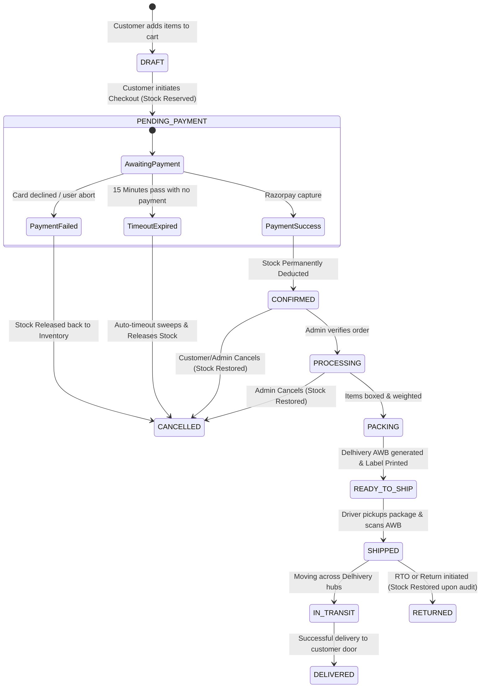
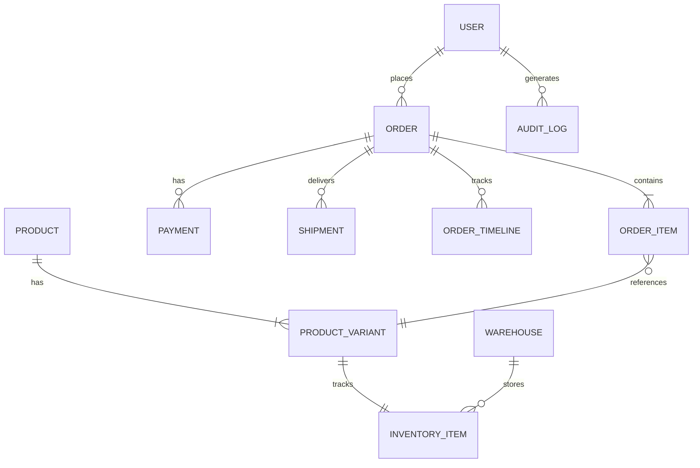

# 🛍️ VASANTHI CREATIONS PVT LTD — Project Master Documentation

**Enterprise Omnichannel Fashion E-Commerce, Mobile POS & Cloud ERP Platform**

*Document Version:* `2.0.0`  
*Last Updated:* October 2026  
*Production Storefront:* [https://vasanthissignature.in](https://vasanthissignature.in)  
*Admin Control Center:* [https://vasanthissignature.in/admin](https://vasanthissignature.in/admin)  
*Backend API Gateway:* [https://api.vasanthissignature.in/api/v1](https://api.vasanthissignature.in/api/v1)  
*Primary AWS Server:* EC2 `16.112.27.175` (Ubuntu 24.04 LTS, Node.js v20, PM2 daemon)

---

## 📑 Table of Contents

1. [Executive Summary & Business Profile](#1-executive-summary--business-profile)
2. [High-Level System Architecture](#2-high-level-system-architecture)
3. [Technology Stack](#3-technology-stack)
4. [GST Architecture & Statutory Compliance](#4-gst-architecture--statutory-compliance)
5. [Order Lifecycle & Payment Gateway Flow](#5-order-lifecycle--payment-gateway-flow)
6. [Inventory Management & Auto-Timeout Engine](#6-inventory-management--auto-timeout-engine)
7. [Logistics & Delhivery Courier Integration](#7-logistics--delhivery-courier-integration)
8. [Point of Sale (POS) & Shopora Mobile App](#8-point-of-sale-pos--shopora-mobile-app)
9. [Database Schema & Core Entities](#9-database-schema--core-entities)
10. [Security, Roles & Access Control (RBAC)](#10-security-roles--access-control-rbac)
11. [DevOps, Deployment & Operations Runbook](#11-devops-deployment--operations-runbook)
12. [Troubleshooting & Emergency Playbook](#12-troubleshooting--emergency-playbook)

---

## 1. Executive Summary & Business Profile

**VASANTHI CREATIONS PVT LTD** (operating under the retail brands **Vasanthi Designers** and **Vasanthi's Signature**) is a modern women's fashion and ethnic wear enterprise. The platform is an end-to-end omnichannel commerce system unifying web storefront sales, retail store Point-of-Sale (POS) operations, multi-warehouse inventory tracking, automated GST compliance, and B2C courier logistics.

### 🏢 Corporate & Statutory Details

| Attribute | Official Record |
| :--- | :--- |
| **Legal Entity Name** | **VASANTHI CREATIONS PVT LTD** |
| **Brand Names** | Vasanthi's Signature, Vasanthi Designers, Shopora POS |
| **GSTIN** | `37ABCFV8491M1ZA` |
| **Primary Store & Warehouse** | Near Bus Stand, Beside Jagadamba Silks, Main Road, Manuguru, Bhadradri Kothagudem District, Telangana - 507117 |
| **Store Phone / Care** | +91 93902 43339 |
| **Customer Support Email** | `care@vasanthissignature.in` |
| **Default Dispatch Pincode** | `507117` |

---

## 2. High-Level System Architecture

```mermaid
graph TD
    subgraph Client Applications
        WebClient["Online Storefront & Mobile Web\n(Next.js 14 App Router)"]
        AdminWeb["Admin & Fulfillment Dashboard\n(Next.js 14 Admin Portal)"]
        POSApp["Shopora Mobile POS App\n(React Native / Expo + ESC/POS)"]
    end

    subgraph CDN & Edge Layer
        VercelCDN["Vercel Global Edge Network\n(Frontend Hosting & SSR)"]
        APIGatewayProxy["Next.js Route Handlers Proxy\n(/api/v1/* -> AWS EC2)"]
    end

    subgraph Cloud Infrastructure (AWS EC2 - 16.112.27.175)
        Nginx["Nginx Reverse Proxy & SSL (Port 443)\napi.vasanthissignature.in"]
        NestApp["NestJS Monolith Service (Port 4000)\n(vasanthi-backend via PM2)"]
        PostgresDB["PostgreSQL 15+ Database\n(Prisma ORM v7)"]
        RedisServer["Redis Cache & Distributed Locks\n(Port 6379)"]
        TimeoutCron["OrderTimeoutService Cron\n(Sweeps 15-min Unpaid Orders)"]
    end

    subgraph Third-Party Cloud Services
        Razorpay["Razorpay Payment Gateway\n(UPI, Cards, Webhooks)"]
        Delhivery["Delhivery B2C Courier API\n(AWB, 4x6 Barcode Labels, Pickups)"]
        AWSS3["AWS S3 Bucket\n(Product Media, Invoices, Barcodes)"]
        Telegram["Telegram Bot Webhooks\n(Real-time Order Alerts)"]
    end

    WebClient --> VercelCDN
    AdminWeb --> VercelCDN
    VercelCDN --> APIGatewayProxy
    APIGatewayProxy --> Nginx
    POSApp --> Nginx
    Nginx --> NestApp
    NestApp --> PostgresDB
    NestApp --> RedisServer
    NestApp --> TimeoutCron
    NestApp --> Razorpay
    NestApp --> Delhivery
    NestApp --> AWSS3
    NestApp --> Telegram
```

---

## 3. Technology Stack

### Frontend & Admin Portal
- **Framework:** Next.js 14.2+ (App Router architecture)
- **Language:** TypeScript 5.3+
- **Styling:** TailwindCSS, Vanilla CSS Modules, CSS custom tokens
- **State & Data Fetching:** TanStack React Query v5, Axios client with retry logic
- **Icons & UI:** Lucide React, Radix UI primitives
- **Thermal Label Engine:** Native 4x6-inch CSS print layout engine with `@media print` rules

### Backend Services
- **Framework:** NestJS 10.3+ (Node.js runtime v20.x LTS)
- **Language:** TypeScript 5.3+
- **Architecture:** Modular Domain-Driven Design (DDD)
- **ORM:** Prisma ORM v7.10 with PostgreSQL connection pool
- **Background Cron:** `@nestjs/schedule` for periodic sweep tasks
- **Logging:** Structured JSON logger with request IDs, trace IDs, and sanitized payloads

### Point of Sale (POS) Mobile Application
- **Framework:** React Native with Expo SDK 51+
- **Language:** TypeScript
- **Hardware Integration:**
  - ESC/POS thermal receipt printers (Bluetooth & USB 58mm / 80mm)
  - Hardware / Camera Barcode Scanner (EAN-13, Code 128)
- **Offline Mode:** SQLite local cart cache with automatic sync on reconnect

### Infrastructure & Cloud Providers
- **Cloud Compute:** AWS EC2 instance (`16.112.27.175`, Ubuntu 24.04 LTS)
- **Process Manager:** PM2 Cluster Daemon (`vasanthi-backend`, PID `106519`)
- **Reverse Proxy & SSL:** Nginx with Let's Encrypt automated TLS certificates
- **Storage:** Amazon Simple Storage Service (S3) for media and label SVGs
- **Edge Deployment:** Vercel for frontend Next.js serverless SSR

---

## 4. GST Architecture & Statutory Compliance

The platform implements an **Indian GST compliant engine** adhering to Central Board of Indirect Taxes and Customs (CBIC) rules for textiles and apparel.

### 💰 Core Pricing Rules
1. **100% Tax-Inclusive Retail Prices:**
   - Every price displayed to retail consumers on the storefront (`mrp` / `price`) **already includes GST**.
   - Customers never see surprise tax surcharges added at checkout.
2. **Apparel Tax Slabs:**
   - **5% GST:** Applied to items with Sale Price $\le$ ₹1,000.
   - **12% GST:** Applied to items with Sale Price > ₹1,000.
3. **Tax Separation Formula (Reverse Calculation):**
   $$\text{Base Taxable Value} = \frac{\text{Selling Price (MRP)}}{1 + \text{GST Rate}}$$
   $$\text{GST Amount} = \text{Selling Price} - \text{Base Taxable Value}$$
4. **Intra-State vs. Inter-State Allocation:**
   - **Intra-State (Inside Telangana - State Code 36):**
     - Split equally: $50\%$ CGST + $50\%$ SGST.
   - **Inter-State (Outside Telangana):**
     - $100\%$ assigned to IGST.

### 🧾 Practical Examples

#### Example 1: Kurti Set (MRP ₹999 — Intra-State Telangana)
- **Item Price:** ₹999.00 ($\le$ ₹1,000 $\rightarrow$ 5% GST slab)
- **Base Taxable Value:** $\frac{₹999.00}{1 + 0.05} = ₹951.43$
- **Total GST (5%):** $₹999.00 - ₹951.43 = ₹47.57$
- **CGST (2.5%):** ₹23.78
- **SGST (2.5%):** ₹23.79
- **Customer Pays:** **₹999.00** (Tax Invoice clearly shows the breakdown)

#### Example 2: Designer Silk Saree (MRP ₹2,999 — Inter-State to Karnataka)
- **Item Price:** ₹2,999.00 (> ₹1,000 $\rightarrow$ 12% GST slab)
- **Base Taxable Value:** $\frac{₹2,999.00}{1 + 0.12} = ₹2,677.68$
- **Total GST (12%):** $₹2,999.00 - ₹2,677.68 = ₹321.32$
- **IGST (12%):** ₹321.32
- **CGST / SGST:** ₹0.00
- **Customer Pays:** **₹2,999.00**

---

## 5. Order Lifecycle & Payment Gateway Flow

### 🔄 Order State Machine



### 🔒 Hard Dispatch & Courier Lock on Unpaid Orders
To prevent dispatching goods without receiving funds:
1. **Admin Order Detail Guard:** The courier assignment button is disabled and displays `🔒 Dispatch Locked: Payment Pending`.
2. **Delhivery Bulk Shipping Screen:** Checkboxes and dispatch actions for unpaid orders (`payment.status === 'PENDING'`) are disabled with an alert badge `⚠️ UNPAID (PENDING)`.
3. **Backend Service Guard (`DelhiveryService.createShipment`):** Throws `DISPATCH_BLOCKED_UNPAID` exception if an attempt is made to generate a Delhivery AWB on an order with uncaptured online payment.

---

## 6. Inventory Management & Auto-Timeout Engine

### 📦 Dual-Stage Inventory Allocation
To prevent overselling while protecting inventory from abandoned carts:
1. **Stage 1 (Checkout Initiation):**
   - When the customer taps "Proceed to Pay", an order in `PENDING_PAYMENT` is created.
   - `inventoryItem.reservedQuantity` is incremented.
   - `inventoryItem.availableQuantity` is reduced.
2. **Stage 2A (Payment Successful):**
   - Order transitions to `CONFIRMED`.
   - `inventoryItem.quantity` (physical stock) is decremented.
   - `inventoryItem.reservedQuantity` is cleared.
3. **Stage 2B (Payment Timed Out / Abandoned):**
   - Background service [`OrderTimeoutService`](file:///c:/Users/duddu/Desktop/aws_vs/vs_web_app/backend/src/domains/order/order-timeout.service.ts) runs every 60 seconds on EC2.
   - Sweeps orders older than 15 minutes in `PENDING` payment state.
   - Decrements `reservedQuantity`, restores `availableQuantity`, and updates `stockStatus` to `IN_STOCK`.
   - Marks order as `CANCELLED` and payment record as `FAILED`.
   - A timeline event is logged: *"Online payment timed out / abandoned UPI. Reserved stock released back to inventory."*

---

## 7. Logistics & Delhivery Courier Integration

The logistics module interfaces directly with Delhivery's B2C Express surface and express parcel APIs.

### 🚚 Shipping Features
- **Automated AWB Allocation:** Real-time generation of Waybill numbers.
- **Single-Sheet 4x6 Thermal Barcode Labels:** Custom printer template calibrated for 4x6 inch thermal paper without layout spillover.
- **Pickup Scheduling & Driver Rosters:** Automated pickup request dispatching to Delhivery's local hub in Manuguru (`507117`).
- **Live Tracking:** Real-time webhook ingestion updating customer and admin dashboards with milestone tracking (`In-Transit`, `Out for Delivery`, `Delivered`).

### 🏷️ Mandatory Shipper Metadata
```json
{
  "registered_name": "VASANTHI CREATIONS PVT LTD",
  "warehouse_name": "Vasanthi Designers Main Store",
  "phone": "+91 93902 43339",
  "gstin": "37ABCFV8491M1ZA",
  "address": "Near Bus Stand, Beside Jagadamba Silks, Main Road, Manuguru, Bhadradri Kothagudem District",
  "state": "Telangana",
  "pincode": 507117
}
```

---

## 8. Point of Sale (POS) & Shopora Mobile App

The retail store at Manuguru operates using the custom **Shopora POS** Android application.

### 📱 Capabilities
- **Quick Billing:** Search by product SKU, name, or barcode scan.
- **Thermal Receipt Printing:** Bluetooth / USB thermal receipt printer (58mm / 80mm ESC/POS) generating tax-compliant customer receipts.
- **Payment Modes:** Cash, Store UPI QR, Credit/Debit card terminal, Split payment.
- **Cashier Shifts:** Shift opening, cash drawer reconciliation, and shift closing reports.
- **Offline Protection:** Local storage queue saves sales if store Wi-Fi drops, synchronizing automatically with the central EC2 database once reconnected.

---

## 9. Database Schema & Core Entities

The PostgreSQL database is managed via Prisma ORM (`prisma/schema.prisma`).



### Core Table Attributes
- **`Order`:** `id`, `orderNumber`, `channel` (`ONLINE_STORE` / `POS_SHOPORA`), `status`, `paymentStatus`, `paymentMethod`, `subtotal`, `taxTotal`, `grandTotal`, `cancelReason`, `createdAt`.
- **`InventoryItem`:** `id`, `productVariantId`, `warehouseId`, `quantity`, `reservedQuantity`, `availableQuantity`, `lowStockThreshold`, `stockStatus` (`IN_STOCK`, `LOW_STOCK`, `OUT_OF_STOCK`).
- **`Payment`:** `id`, `paymentNumber`, `orderId`, `method`, `status` (`PENDING`, `CAPTURED`, `FAILED`, `REFUNDED`), `amount`, `providerOrderId`, `providerPaymentId`.
- **`Shipment`:** `id`, `orderId`, `carrier` (`DELHIVERY`), `trackingNumber` (AWB), `status`, `labelUrl`, `pickupDate`.

---

## 10. Security, Roles & Access Control (RBAC)

Access is enforced via JWT Bearer tokens and role-based guards on backend API endpoints.

| Role | Permissions & Scope |
| :--- | :--- |
| **`SUPER_ADMIN`** | Full access: system settings, staff management, financial reports, AWS billing dashboard, emergency inventory overrides. |
| **`STORE_MANAGER`** | Catalog editing, price adjustments, stock intake, discount campaigns, order cancellations. |
| **`DISPATCH_STAFF`** | Order packing, Delhivery AWB generation, thermal label printing, driver pickup rosters. |
| **`CASHIER`** | POS billing, customer creation, shift management, thermal receipt printing. |
| **`CUSTOMER`** | Storefront browsing, profile management, order placement, live tracking, order cancellation within allowed window. |

---

## 11. DevOps, Deployment & Operations Runbook

### 🖥️ Production Environment Details
- **Server:** AWS EC2 `16.112.27.175`
- **User:** `ubuntu`
- **SSH Key:** `vs-app-key.pem`
- **App Directory:** `/home/ubuntu/vs_web_app`
- **Backend Directory:** `/home/ubuntu/vs_web_app/backend`
- **PM2 Process Name:** `vasanthi-backend` (Port `4000`)
- **Database:** PostgreSQL on `localhost:5432/vs_web_db`

### 🚀 Standard Deployment Procedure

#### 1. Backend Update on EC2:
```bash
# SSH into EC2
ssh -i "path/to/vs-app-key.pem" ubuntu@16.112.27.175

# Pull latest code
cd /home/ubuntu/vs_web_app
git pull origin claude/project-us-states-0ursd0

# Build and restart backend
cd backend
npm run build
pm2 restart vasanthi-backend

# Verify logs & health
pm2 logs vasanthi-backend --lines 30 --nostream
curl -s http://127.0.0.1:4000/health
```

#### 2. Frontend Update on Vercel:
The frontend is connected to GitHub. When changes are pushed to `main` or the active deployment branch, Vercel automatically runs `npm run build` and deploys the new bundle to the global edge network.

---

## 12. Troubleshooting & Emergency Playbook

### ❓ Issue 1: Stock is Locked on an Abandoned Order
- **Symptom:** Variant displays "Out of Stock" or low stock, but no payment was made.
- **Cause:** Customer began checkout and abandoned payment; order stayed in `PENDING_PAYMENT`.
- **Resolution:**
  - Automated: `OrderTimeoutService` sweeps and releases stock within 15 minutes.
  - Manual Trigger: Admin can invoke `POST /api/v1/orders/sweep-expired` or cancel the order from the admin order detail page.

### ❓ Issue 2: Delhivery Label Printing Fails
- **Symptom:** Admin clicks "Generate AWB" and receives an error.
- **Checklist:**
  1. Verify the order payment status: If `payment.status === 'PENDING'`, dispatch is intentionally locked until payment is captured.
  2. Verify recipient pincode: Delhivery requires a valid 6-digit Indian pincode.
  3. Verify Delhivery API token in EC2 `.env` (`DELHIVERY_API_TOKEN`).

### ❓ Issue 3: Backend API Unreachable (502 Bad Gateway)
- **Checklist:**
  ```bash
  ssh -i "path/to/vs-app-key.pem" ubuntu@16.112.27.175
  pm2 status
  pm2 logs vasanthi-backend --err --lines 50
  sudo systemctl status nginx
  ```
- **Restart Backend:**
  ```bash
  pm2 restart vasanthi-backend
  ```

---

*Authored by Antigravity Engineering for VASANTHI CREATIONS PVT LTD.*
